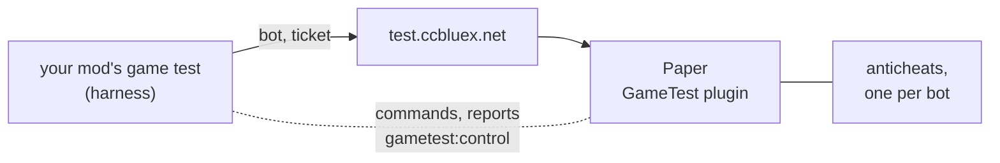

# gametest

Client game tests for Fabric mods against a real Paper server, with an anticheat of your choice watching. Every
test joins under a bot name of its own, gets worlds of its own, drives them with commands, and fails when the
server or its anticheat objects to what the client did. Tests of many CI runs share one server without meeting.



| Directory | What |
| --- | --- |
| `harness/` | The Fabric library tests are written with, published as `net.ccbluex:gametest-harness` |
| `plugin/` | The Paper plugin: sessions and their worlds, isolation, the control channel, anticheat reports |
| `server/` | The server image with its anticheats and configuration |
| `docs/` | [The anticheats](docs/anticheats.md) and [the protocol](docs/protocol.md) |
| `skills/` | [An agent skill](skills/gametest-harness/SKILL.md) with the harness API and the rules a test follows |

Minecraft 26.3 on Java 25.

## Writing tests

```kotlin
repositories {
    maven("https://maven.ccbluex.net/releases")
}

dependencies {
    // In the client game test source set that fabricApi.configureTests creates
    "gametestImplementation"("net.ccbluex:gametest-harness:2.0.0+26.3")
}
```

The harness needs Fabric API and Fabric Language Kotlin at runtime.

The class a test extends says where it plays:

| Class | Plays | Runs when |
| --- | --- | --- |
| `ServerGameTest` | on the game test server, the chosen anticheats judge it | `GAMETEST_SERVER_ANTICHEAT` is set, with a token or an address |
| `SingleplayerGameTest` | in a singleplayer world of the client's integrated server, nothing judges it | `GAMETEST_SERVER_ANTICHEAT` is unset |
| `ClientGameTest` | on the title screen, no world | `GAMETEST_SERVER_ANTICHEAT` is unset |

```kotlin
class AutoShearerGameTest : ServerGameTest({
    give("minecraft:shears")
    summon("minecraft:sheep", origin.south(2), "{NoAI:1b}")
    // ... switch on what is under test
    awaitServer("entity @e[type=minecraft:sheep,nbt={Sheared:1b}]")
})

class ChestFinderGameTest : SingleplayerGameTest({
    setBlock(origin.south(5), "minecraft:chest")
    // ... same scope, TestWorld and commands as on the server
})

class ConfigGameTest : ClientGameTest({ context ->
    context.runOnClient<RuntimeException> { /* ... */ }
})
```

Register each test as a `fabric-client-gametest` entrypoint, and `net.ccbluex.gametest.harness.ResultsGameTest`
last. A server or singleplayer test passes with up to `violationLevel` (5) flags, corrections and errors, and a
failed one runs again up to `retries` (2) times; both can be overridden per test. A client test runs once.
Use a singleplayer test for what the client finds, shows or keeps, with nothing for an anticheat to judge.

A mod puts its own state in order with a `GameTestSetup`, registered as a `gametest-setup` entrypoint. A Kotlin
`object` needs the `kotlin` adapter; a class with a public no-arg constructor takes a plain string. Every registered
setup runs around every test, in entrypoint order:

```kotlin
object MyModSetup : GameTestSetup {
    override fun awaitClient(context: ClientGameTestContext) = Unit // wait for the mod's startup after the title screen
    override fun beforeTest(context: ClientGameTestContext) = Unit  // settings back to defaults, before the join
    override fun afterTest(context: ClientGameTestContext) = Unit   // after leaving, passed or not (reverse order)
}
```

```json
"entrypoints": {
  "gametest-setup": [{ "adapter": "kotlin", "value": "com.example.gametest.MyModSetup" }]
}
```

| Variable | Meaning |
| --- | --- |
| `GAMETEST_API_TOKEN` | The API token from your [LiquidBounce account](https://liquidbounce.net/account). Needed for the public server. |
| `GAMETEST_SERVER_ANTICHEAT` | Which [anticheats](docs/anticheats.md) watch the bots, comma separated: `grim` or `intave,mx`. Unset, the run plays the singleplayer and client tests instead. |
| `GAMETEST_SERVER_ADDRESS` | Another server, such as `localhost:25565`; then no token is needed. |

With anticheats chosen but neither a token nor an address the server tests are skipped.
`-Dgametest.only=AutoShearer,Config` runs only those classes, of any kind.

The console shows a line per test; on GitHub Actions (or with `-Dgametest.console=tests`) nothing else, with
failures as annotations and a table in the job summary. `-Dgametest.console=all` keeps the whole client log there;
`logs/latest.log` always has it.

## The public server

`test.ccbluex.net` lets bots in that show a ticket from the LiquidBounce API, which the harness gets with its
token while it logs in. Every bot is logged with the account behind its token, an account that misuses the server
is banned, and one account runs at most 5 bots at a time.

In GitHub Actions, give the job the token as a secret and run the suite once per anticheat:

```yaml
strategy:
  matrix:
    anticheat: [...]  # values from docs/anticheats.md
env:
  GAMETEST_API_TOKEN: ${{ secrets.LIQUIDBOUNCE_API_TOKEN }}
  GAMETEST_SERVER_ANTICHEAT: ${{ matrix.anticheat }}
```

## Running the server

```sh
./gradlew :plugin:build
docker compose up --build
GAMETEST_SERVER_ADDRESS=localhost:25565 GAMETEST_SERVER_ANTICHEAT=grim ./gradlew runClientGameTest   # in the mod
```

Starting it means agreeing to the [Minecraft EULA](https://aka.ms/MinecraftEULA). It downloads Grim and Intave; the paid
anticheats are only on the public server.

## License

[GPL-3.0](LICENSE)
